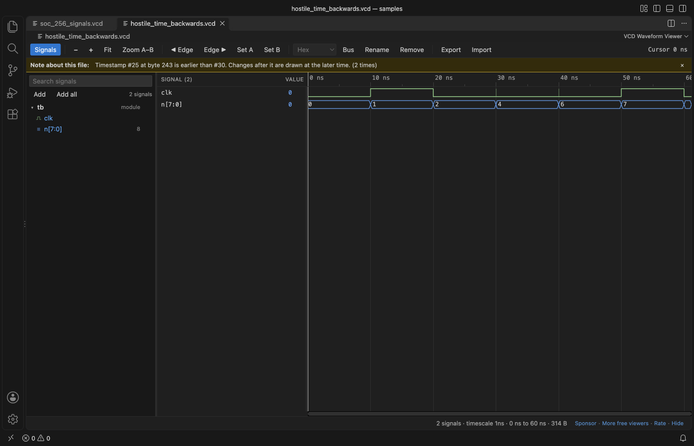
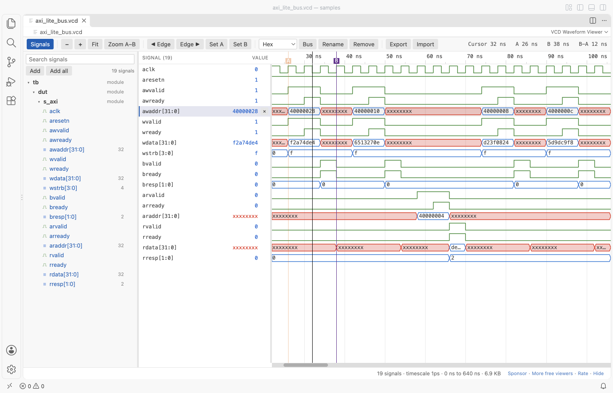

# VCD Viewer & Waveform Viewer (Verilog, No Signal Limit)

Click a `.vcd` file from Icarus Verilog, Verilator, Vivado, ModelSim or GHDL and see its waveforms in VS Code. Free, no sign-in, works offline, and there is no limit on how many signals you show.

![An AXI-Lite bus VCD open in VCD Waveform Viewer inside VS Code. The signal tree on the left lists the 19 signals of tb.dut.s_axi. The middle column shows each signal's value at the cursor, such as awaddr 40000028 and wdata f2a74de4. The waveforms show the valid and ready handshakes as green lines and the 32-bit address and data buses as blue shapes with hex values, while undefined x values are red. Marker A sits where awvalid rises at 26 ns, marker B where bvalid falls at 38 ns, and the toolbar reads B−A 12 ns](https://github.com/theluckystrike/vcd-viewer-vscode/raw/HEAD/images/readme-axi-dark.png)

*Real output from VS Code on macOS. The file is `axi_lite_bus.vcd`, made by `scripts/make_samples.py`. `scripts/e2e-vscode.mjs` installed the packaged extension in a clean VS Code profile, opened the file, placed the markers with real key presses (A and B, after jumping to the edges with the arrow keys) and saved the window through the debug port.*

- There is no signal limit. Add one signal, a whole scope or all 20,000 signals of a file. The rows are drawn only where you look, so 250 rows scroll as fast as 5.
- The values are checked. Every release is checked in a real VS Code against a separate reference reader: all signals of 16 sample files at 5 cursor times, including 4-state values, short vectors that need left extension, real numbers, strings and `$dumpoff`.
- Scrolling works the way you expect. The wheel scrolls the signal list. Shift+wheel, a trackpad swipe, a drag or the bar under the waves moves through time. Ctrl or Cmd+wheel zooms at the mouse.
- Large files open fast. A 1.07 GB VCD with 20,000 signals showed its first waves after 4.3 s. A signal that changes now and then appeared 0.06 s after you added it, and one that changes all the time in 0.73 s. The file is never read into memory as a whole.

## Quick start

1. Install VCD Viewer & Waveform Viewer.
2. In your testbench, dump a VCD: `$dumpfile("wave.vcd"); $dumpvars(0, tb);` (Verilog), `--vcd=wave.vcd` (GHDL) or `--trace` (Verilator).
3. Click the `.vcd` file in the Explorer. The first 64 signals show right away.

Double-click a signal in the tree to add it, or press **+** next to a scope to add every signal in it. If another viewer opens the file, right-click it and pick "Open in VCD Waveform Viewer". "VCD Waveform Viewer: Get Started" in the Command Palette opens a short tour.

## Find your way in time

| Do this | To |
|---|---|
| Ctrl or Cmd + wheel, or pinch | Zoom at the mouse |
| Drag, Shift + wheel, a trackpad swipe, or the bar under the waves | Move through time |
| Shift + drag, or drag on the time ruler | Zoom to that range |
| `F` or Fit | Show the whole simulation |
| Click | Put the cursor there. The Value column shows every signal at the cursor. |
| Left and Right arrow (or `P` and `N`) | Jump to the previous or next change of the selected signal |
| `A` and `B` | Put marker A or B at the cursor. The toolbar shows the time between them. |
| Zoom A–B | Zoom to the range between the markers |

Times show in the unit that fits the zoom (fs, ps, ns, µs, ms or s), from the file's `$timescale`.

## Organize the signals

| Do this | To |
|---|---|
| Radix menu in the toolbar | Show the selected signals in hex, binary, unsigned, signed or ASCII. Integer variables start as signed. |
| Ctrl/Cmd + click, Shift + click | Select several signals |
| Bus, or `G` | Group the selected signals into one bus. The top one is the most significant bit. Press again to split it. |
| Double-click a name, or `F2` | Rename a signal. The real name stays in the tooltip. |
| Drag a row, or Alt + Up/Down | Move signals |
| `Delete` | Remove the selected rows from the view |
| Double-click a value | Copy it |
| Type in the box above the tree | Search. Every word must match, so `axi data` finds `tb.dut.s_axi.wdata`. |

Undefined values are red and high-impedance values are yellow, in the waves and in the Value column. A hex digit is `x` or `z` when all 4 bits are, and `X` or `Z` when only some are. VHDL values `U`, `W`, `L`, `H` and `-` from GHDL are shown too.

## Your signal list is kept

The viewer remembers the signals, radixes, names, zoom, cursor and markers for each file, on this computer only. When the simulator writes the file again, the viewer reads it again and keeps your list. Export saves the list as a `.signals.json` file you can commit next to the testbench, and Import loads it into another file.

## Large files

The file is read in blocks by a background thread. The first pass builds an index of which block holds changes of which signal. When you add a signal, only those blocks are read again, by up to 8 threads at once. Measured in a real VS Code on a 1.07 GB file with 20,000 signals (Apple silicon, other programs running):

| Step | Time |
|---|---|
| Signal tree shown | 0.13 s |
| First waves shown | 4.3 s |
| Add a signal with 2 changes | 0.06 s |
| Add a signal with 81,173 changes spread over the whole file | 0.73 s |
| Memory of the VS Code extension host at its peak | 552 MB |

While many other programs were busy on the same computer, the same steps took up to 13 s for the first waves and 4.5 s for the busy signal. A progress bar shows while the file is read. Files larger than the `vcdViewer.maxFileMB` setting (16 GB) show a message instead.

## Files that are not quite right

The viewer opens damaged files and tells you what is wrong, in a bar above the waves:

- a file cut off in the middle of a value change (a simulation that was stopped),
- a timestamp that goes back in time,
- a signal declared twice, or a value change for an identifier that no `$var` declares.

A file that is not a VCD at all shows a short message instead of a blank page.

## Settings

| Setting | Default | What it does |
|---|---|---|
| `vcdViewer.defaultRadix` | hex | Radix for vector signals when you add them |
| `vcdViewer.initialSignals` | 64 | Signals shown when a file opens for the first time (16 at most for files over 200 MB) |
| `vcdViewer.autoReload` | true | Read the file again when the simulator writes it |
| `vcdViewer.rowHeight` | normal | compact, normal or large rows |
| `vcdViewer.maxFileMB` | 16384 | Larger files show a message and are not read |
| `vcdViewer.askForRating` | true | Ask one time for a Marketplace rating after a few days of use |
| `vcdViewer.showSupportLinks` | true | Show the small Sponsor and More free viewers links |

Dark, light and high-contrast themes are followed, including the colours of the waves.

## Privacy and safety

No network calls, no telemetry, no account. The webview has a content security policy of `default-src 'none'`, and the file is opened read-only: the viewer never writes to your VCD. The signal list is kept in VS Code's own storage. The install is about 180 KB.

## Limits

- VCD only for now. FST, GHW and LXT files are not read yet.
- Real values are drawn as values in a bus shape, not as an analog curve.
- GTKWave `.gtkw` save files are not read. Use Export and Import for signal lists.

## Support Zovo

Zovo extensions are free, with no ads and no tracking. They are made by [theluckystrike](https://github.com/theluckystrike) on GitHub. If this one saves you time, you can support the work:

- [Sponsor on GitHub](https://github.com/sponsors/theluckystrike)
- [Follow theluckystrike on GitHub](https://github.com/theluckystrike)

## More tools by Zovo

- [XLSX Viewer, Excel Viewer, CSV Viewer & Parquet Viewer](https://marketplace.visualstudio.com/items?itemName=zovo.table-viewer-vscode) opens CSV, TSV, Excel and Parquet files as a sortable, filterable table.
- [Graphviz Viewer & DOT Viewer (Live Preview)](https://marketplace.visualstudio.com/items?itemName=zovo.zovo-graphviz-preview) shows a live preview of DOT files, such as state machine diagrams, and exports SVG or PNG.
- [Audio Player & WAV Player, Music & Wave Viewer (MP3, FLAC)](https://marketplace.visualstudio.com/items?itemName=zovo.audio-preview-vscode) plays audio files with a waveform, a spectrogram and LUFS loudness.
- [NetCDF Viewer & HDF5 Viewer (NC Viewer, H5 Viewer)](https://marketplace.visualstudio.com/items?itemName=zovo.hdf5-netcdf-explorer) browses groups, attributes and values in HDF5 and NetCDF files and plots slices.
- [Large JSON Viewer, JSON Browser & JSON Tree](https://marketplace.visualstudio.com/items?itemName=zovo.zovo-json-tree-viewer) shows large JSON files as a searchable tree and copies JSONPath.

See [all Zovo extensions on the Marketplace](https://marketplace.visualstudio.com/publishers/zovo).

## License

MIT
